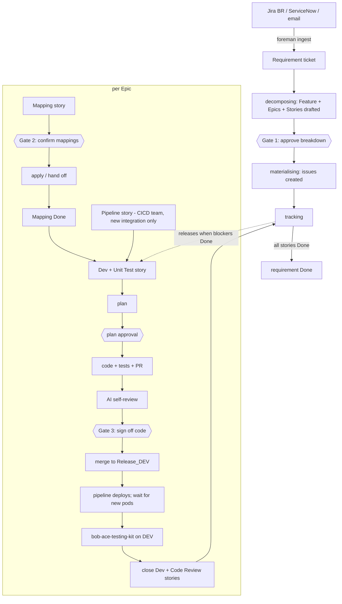

# AI-SDLC Foreman setup guide

How to stand up the AI-SDLC flow, from prerequisites to a live pilot. For the
list of things **the client must supply**, give them
[CLIENT-REQUIREMENTS.md](CLIENT-REQUIREMENTS.md) — this guide is for whoever
installs Foreman.

---

## What AI-SDLC adds over the base Foreman

The base product takes one Jira ticket through *triage → plan → build → deploy
→ test → sign-off → close*. AI-SDLC keeps all of that and puts a requirement
layer in front of it and a real DEV rollout behind it.

| Area | Base Foreman | AI-SDLC |
|---|---|---|
| Intake | Tickets labelled `foreman` | Same, **plus** `foreman ingest` from a Jira BR board, ServiceNow, or IMAP email |
| Unit of work | One ticket | A **requirement** → one **Feature** → an **Epic** per interface → **eight story types** per Epic |
| Gates | Plan, sign-off | Breakdown (Gate 1), mappings (Gate 2), plan, code + review (Gate 3) |
| Mappings | — | Read/write through the **TapiForge MCP**, or a CSV/JSON a person applies |
| Dependencies | — | Dev is held back (`foreman-blocked`) until Mapping **and** Pipeline are Done |
| Code | Code, then a separate verify stage writes tests | Code **and** tests in one pass; the build stage runs the tests before pushing |
| Review | Human only | An AI self-review of the diff is posted before Gate 3 |
| Merge | Optional, at the end | After Gate 3: PR merged into the **DEV branch** (`Release_DEV`) |
| Deploy | Simulated / Actions / webhook | Adds `okd`: polls `oc get pods` until the **new** pods are Ready |
| Tests | After deploy, before sign-off | `bob-ace-testing-kit` against DEV **after** the rollout |
| Close | Closes ticket, raises prod ticket | Closes the story; the requirement closes when **all** stories are Done. No prod ticket is raised (a Production Deployment story already exists) |

Unchanged: the state machine's one-step-per-run rule, the gate checks, the
guardrails, diff inspection, the dry-run/live interlocks, and "Bob proposes, the
harness disposes".

### The flow



People, not Foreman, work: Pipeline, Regression, Enterprise QA, Production
Deployment, Production Validations.

---

## Prerequisites

| Need | Check |
|---|---|
| Python 3.9+ (stdlib only, nothing to `pip install`) | `python3 --version` |
| Bob Shell 1.0.x or 2.x | `bob --version` |
| `git` | `git --version` |
| `oc` or `kubectl`, logged in, if `FOREMAN_DEPLOY_MODE=okd` | `oc get pods -n <ns>` |
| Network access to Jira, GitHub, Bob, and (as used) TapiForge, ServiceNow, IMAP, the OpenShift API | |

Everything the client must supply is in [CLIENT-REQUIREMENTS.md](CLIENT-REQUIREMENTS.md).

---

## Setup

### 1. Configure `.env`

```bash
cd ai-sdlc-foreman-ai-sdlc
cp .env.example .env && chmod 600 .env
```

Minimum for a dry run: `BOB_API_KEY` (+ `BOB_TEAM_ID` on 2.x), `JIRA_SITE`,
`JIRA_EMAIL`, `JIRA_API_TOKEN`, `JIRA_PROJECT`, `FOREMAN_APPROVERS`, and
`GITHUB_*` with `FOREMAN_GIT_MODE=github`.

The AI-SDLC settings, grouped (all documented in `.env.example`):

| Group | Variables |
|---|---|
| Hierarchy | `FOREMAN_FEATURE_ISSUETYPE` (`none` to skip Features), `FOREMAN_EPIC_ISSUETYPE`, `FOREMAN_STORY_ISSUETYPE`, **Data Center:** `FOREMAN_EPIC_LINK_FIELD`, `FOREMAN_FEATURE_LINK_FIELD`, `FOREMAN_EPIC_NAME_FIELD` |
| Intake query | `JIRA_INTAKE_JQL` — must select `foreman` **and** `foreman-requirement`, and exclude `foreman-blocked` (see below) |
| Sources | `INTAKE_JIRA_SOURCE_JQL`, `SNOW_*`, `IMAP_*` |
| Mappings | `FOREMAN_MAPPING_MODE`, `TAPIFORGE_MCP_*` |
| Git / merge | `FOREMAN_BASE_BRANCH` (= the DEV branch), `FOREMAN_AUTO_MERGE`, `FOREMAN_MERGE_METHOD` |
| Deploy | `FOREMAN_DEPLOY_MODE=okd`, `FOREMAN_OKD_NAMESPACE`, `FOREMAN_OKD_LABEL_SELECTOR`, `FOREMAN_OKD_POD_TIMEOUT_SEC` |
| Tests | `FOREMAN_TEST_COMMAND` (DEV, after rollout), `FOREMAN_BUILD_TEST_COMMAND` (before push) |

The intake query that makes the dependency labels work:

```
JIRA_INTAKE_JQL="project = FORE AND labels in (foreman, foreman-requirement) AND labels not in (prod-deployment, foreman-blocked) AND statusCategory != Done"
```

A requirement stays open in state `tracking` until all its stories are Done, so
the query must keep matching it while it is open — this one does.

### 2. Install the Bob modes into the repository Foreman will work on

```bash
bash extension/install.sh /path/to/the/repo
```

Installs nine modes: `foreman-triage`, `-plan`, `-critic`, `-build`, `-verify`,
`-decompose`, `-mapping`, `-mapping-apply`, `-codereview`. Then fill in
`.bob/rules/01-repo-policy.md` — the installer warns while it is a placeholder.

### 3. Let the AI touch ACE files (client-specific)

Out of the box the build stage cannot edit `.msgflow`, `.esql`, `.xsl`, `.xsd`.
Widen **both** `policy/guardrails.yaml` (`allow_paths`) and the `fileRegex` of
`foreman-build` in `extension/custom_modes.yaml`, then re-run `install.sh`. See
CLIENT-REQUIREMENTS §9. Do this after a few clean runs, not first.

### 4. Doctor

```bash
cd harness && python3 -m foreman doctor
```

Checks Bob, Jira, the approvers, git, the policy files, and the AI-SDLC section:
issue types, the intake query, merge mode, `oc` and the pod selector (it runs
`oc get pods` for real), the TapiForge tool lists, and half-configured sources.
**Fix everything it lists before going live.**

### 5. Dry run

```bash
python3 -m foreman ingest --source all --dry-run
python3 -m foreman run                       # reads, reports, writes nothing
python3 -m foreman show <KEY>
```

Writing needs **both** `--live` and `FOREMAN_WRITE=true`.

---

## Mappings: choosing how (TapiForge)

| | Option 1 — MCP read + write | Option 2 — MCP read, person writes |
|---|---|---|
| Set | `TAPIFORGE_MCP_*` and **both** `TAPIFORGE_MCP_READ_TOOLS` and `TAPIFORGE_MCP_WRITE_TOOLS` | `TAPIFORGE_MCP_*` and only `…READ_TOOLS` |
| Drafting | AI reads current mappings, proposes changes | same |
| Gate 2 | person confirms | person confirms |
| After Gate 2 | AI writes via the write tools and reports per target | a CSV + JSON is attached to the story; the person applies it and the story closes |

With no TapiForge MCP at all, set nothing: it runs in **file mode** (same as
Option 2, but the AI proposes from the ticket and repo alone, and the Gate 2
comment carries a warning that nothing was checked against TapiForge).

How it is kept safe: the MCP server is written into the disposable checkout's
`.bob/mcp.json` only, `.bob/` is removed before any diff is taken, only the
mapping stages run with MCP enabled, **write tools are not auto-approved until
after Gate 2**, the apply stage records each applied target so a retry never
repeats a write, and the token is scrubbed from every comment and log.

Tool names are the client's to supply — Foreman does not guess them.

---

## CP4i / OKD rollout

```bash
FOREMAN_DEPLOY_MODE=okd
FOREMAN_OKD_NAMESPACE=ace-dev
FOREMAN_OKD_LABEL_SELECTOR=app=ace-orders
FOREMAN_OKD_POD_TIMEOUT_SEC=900
```

After the merge, Foreman polls `oc get pods -o json` every 15 s and declares the
rollout finished only when **all** hold, on **two consecutive** reads: at least
one pod matches; none is terminating; every pod is `Running` with all containers
ready; and every pod's `creationTimestamp` is later than the merge time (minus
`FOREMAN_OKD_CLOCK_SKEW_SEC`). The last rule is what stops pods from the old
version being mistaken for the new one. If the selector matches nothing, or the
timeout passes, the ticket goes to `failed`.

`FOREMAN_DEPLOY_WEBHOOK` can additionally be POSTed to for pipelines that need an
explicit trigger. The AI never touches the cluster.

---

## Gates

| Gate | State | Reviewer sees | Approve → |
|---|---|---|---|
| 1 | `awaiting-epic-approval` | Feature / Epic / Story tree, impact analysis | issues are created |
| 2 | `awaiting-mapping-review` | each mapping change, current vs proposed | mappings applied / handed off |
| — | `awaiting-approval` | analysis and change plan | code is written |
| 3 | `awaiting-signoff` | diff, tests, AI self-review | PR merged to DEV |

Reply on the ticket: `/foreman approve`, `/foreman changes <what>`,
`/foreman reject <why>`. One approver list (`FOREMAN_APPROVERS`) covers all four.

---

## When something fails

A failed stage sets `foreman:failed` and records **where** it failed. After the
cause is fixed, add a comment on the ticket (or edit it):

* **Resumable** stages — materialising, tracking, applying-mapping, committed,
  merging, deploying, deployed, closing — are simply run again. An approved plan
  is not thrown away, issues already created are not duplicated, and mappings
  already applied are not re-written.
* Anything earlier restarts from intake, because its premises may have changed.

| Symptom | Cause | Fix |
|---|---|---|
| Gate never passes | `FOREMAN_APPROVERS` empty or wrong id | set it; `doctor` shows whether *you* are on the list |
| Requirement never picked up | intake JQL lacks `foreman-requirement` | use the query above |
| Dev story never starts | Mapping or Pipeline story not Done; or JQL doesn't exclude/include `foreman-blocked` correctly | close the blockers (Foreman releases it on the next run) |
| Epic/Story creation refused | issue type name, a mandatory field, or (DC) missing link-field id | CLIENT-REQUIREMENTS §3.2; retry — already-created issues are kept |
| `mode foreman-… not found` | modes not installed | `bash extension/install.sh <repo>` |
| Build stage rejected for a file | outside `allow_paths` / `fileRegex` | §3 above, deliberately |
| Merge refused | branch protection / conflict / required check | resolve, then comment to retry |
| `no pods matched the selector` | wrong selector | `oc get pods -n <ns> -l <selector>` |
| `pods from before the merge still running` | pipeline hasn't replaced pods yet, or it doesn't replace them | wait; or see CLIENT-REQUIREMENTS §7 |
| DEV tests fail | code or environment | fix, then comment to re-run; Foreman never retries a failed run itself |
| Requirement won't close | a story isn't in a *Done* status category, or the transition to "Done" isn't available | close it by hand |

---

## Known limits (be upfront with the client)

* **Not verified against live systems.** The logic is tested offline against fakes
  (157 tests). Nothing has been run against a real TapiForge MCP, a real CP4i
  cluster, or the client's Jira. Expect a short shake-down in the pilot.
* **TapiForge tool names and behaviour** are unknown until the client supplies
  them; the prompts are generic about *what* to read and write.
* **One approver list** for every gate (no per-gate separation of duties).
* **ACE file types are not editable by default** (deliberate; §3 above).
* **The AI "code review" is advisory** — it is a second look at its own diff, not
  independent review; Gate 3 is the control.
* **Pipeline test stage (Option 2)** is only supported as a command that returns an
  exit code.
* Flows that reload without replacing pods will never satisfy the pod rule.
